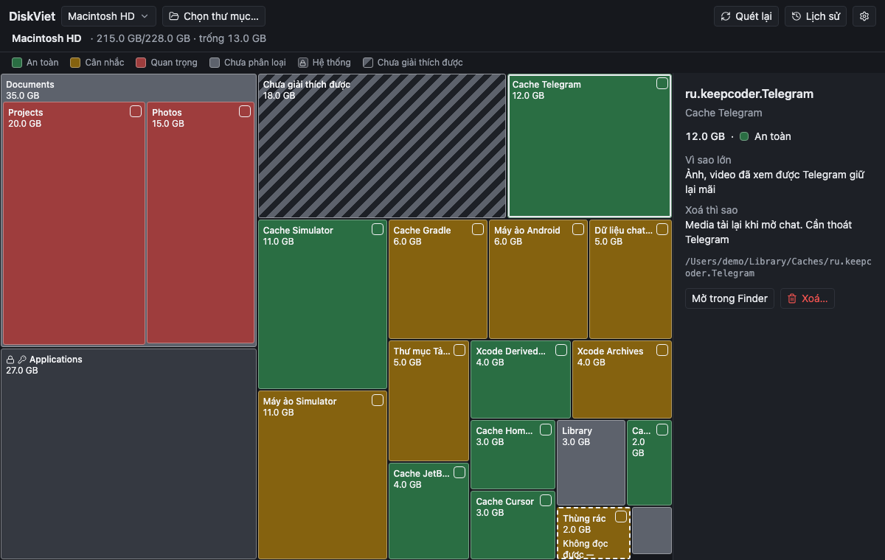

<p align="center"></p>

<h1 align="center">DiskViet</h1>

<p align="center">Dọn ổ đĩa macOS nhanh mà không xoá nhầm dữ liệu quan trọng.<br>
<em>A macOS disk cleaner that shows what is safe to delete — and why.</em></p>



## Tính năng

- **Treemap** toàn ổ hoặc một thư mục: ô càng to càng chiếm nhiều chỗ, màu = mức an toàn. Ô lớn hiện luôn thư mục con bên trong (tắt được trong Cài đặt).
- **Giải thích từng vùng**: vì sao nó lớn, xoá thì mất gì, có tự tạo lại không — ~47 quy tắc cho macOS và công cụ lập trình (Xcode, Simulator, Android, Gradle, Flutter, npm/pnpm, pip, CocoaPods, Homebrew, Docker, cache trình duyệt và ứng dụng chat…).
- **Xoá an toàn**: chọn nhiều ô, mỗi mục chọn Thùng rác hoặc Xoá hẳn; dữ liệu quan trọng phải tick xác nhận; app đang chạy thì nhắc thoát trước; mục cần quyền admin chỉ hỏi mật khẩu một lần.
- **Dọn bằng công cụ chính chủ** khi có: `brew cleanup`, `xcrun simctl`, `docker system prune` (không xoá volume).
- **Con số trung thực**: dung lượng tính theo block thực trên đĩa, hard link đếm một lần, không đếm đôi firmlink; sau khi xoá hiện dung lượng trống **đo được** trước/sau.
- Lịch sử xoá, Tiếng Việt / English, nhẹ (bộ cài ~2 MB).

| Màu | Mức | Ý nghĩa |
|---|---|---|
| 🟩 | An toàn | Cache, file build — tự tạo lại được |
| 🟨 | Cân nhắc | Xoá được nhưng mất tiện ích: máy ảo, SDK, lịch sử chat, file đã tải |
| 🟥 | Quan trọng | Dữ liệu của bạn — phải xác nhận mới xoá hẳn |
| ⬜ | Chưa phân loại | Không khớp quy tắc — xử lý như Quan trọng |
| 🔒 | Hệ thống | Hệ điều hành, ứng dụng, cấu hình — chỉ xem |

Mọi lệnh xoá đi qua một hàng rào duy nhất trong Rust (`src-tauri/src/guard.rs`): từ chối thư mục hệ thống, thư mục gốc, thư mục cha của home, không đi theo symlink, không vượt sang ổ khác.

## Yêu cầu

- macOS (Apple Silicon hoặc Intel). Nên cấp **Full Disk Access** để quét được Mail, Tin nhắn, bản sao lưu iPhone.
- Để build: [Rust](https://rustup.rs) (stable), Node.js ≥ 24, pnpm.

## Build & chạy

```bash
pnpm install
pnpm tauri dev          # chạy app
pnpm tauri build        # → src-tauri/target/release/bundle/{macos,dmg}/
pnpm dev:mock           # chỉ giao diện, dữ liệu giả, không đụng ổ thật
```

Kiểm tra:

```bash
pnpm typecheck && pnpm lint && pnpm test:ts && pnpm test:e2e && pnpm rs:check && pnpm rs:test
```

Bản build chưa ký (code-sign): lần đầu mở, bấm chuột phải → **Mở**.

## Tài liệu

- [docs/DESIGN.md](docs/DESIGN.md) — thiết kế, mô hình an toàn, danh mục quy tắc.
- [docs/DECISIONS.md](docs/DECISIONS.md) — vì sao chọn từng thư viện.
- [docs/PERF.md](docs/PERF.md) — số đo hiệu năng.

## Giấy phép

[PolyForm Noncommercial 1.0.0](LICENSE) — được dùng, sửa và chia sẻ cho mục đích **phi thương mại**. Muốn dùng thương mại, hãy liên hệ tác giả.
